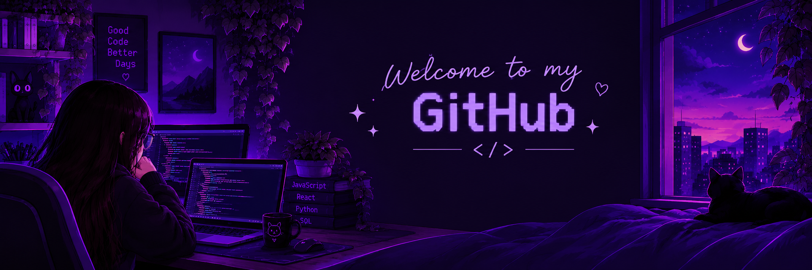
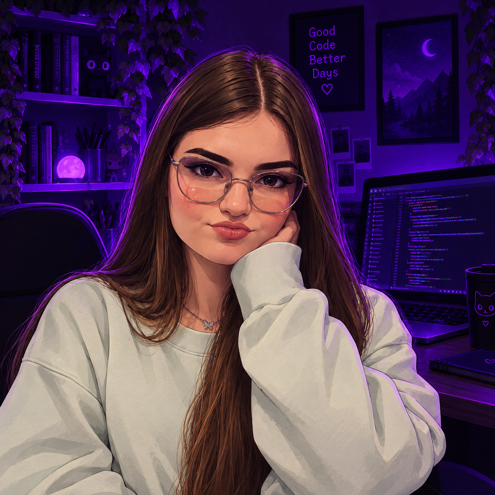

  

<!-- TEXTO ANIMADO -->

 

<!-- REDES SOCIAIS: TROQUE OS LINKS -->

<!-- TECNOLOGIAS -->
<h2 align="center">⌘ Tecnologias</h2>

---

<!-- SOBRE MIM -->
<h2 align="center">⌘ Sobre mim</h2>

  

  <h3>Olá! 👋</h3>

  

   Sou Bruna Provin, estudante de Engenharia de Software e apaixonada por tecnologia e inovação. Atualmente, estou desenvolvendo meus conhecimentos em programação e explorando diferentes tecnologias para criar projetos que transformem ideias em soluções reais. 🚀

Gosto de aprender coisas novas, enfrentar desafios e aprimorar minhas habilidades a cada projeto. Meu objetivo é crescer profissionalmente na área de desenvolvimento de software, construir aplicações úteis e evoluir continuamente como desenvolvedora. 💜

Acredito que cada linha de código é uma oportunidade de aprender, criar e ir além. ✨
  

 

<!-- PROJETOS
<h2 align="center">⌘ Projetos em destaque</h2>

  -->

<!-- HOBBIES
<h2 align="center">⌘ Hobbies & objetivos</h2>

  -->

<!-- TROQUE PELO SEU GIF  
-->

  

🌙 Aprender • 💜 Criar • 🚀 Evoluir

*"O melhor projeto é aquele que nos ensina algo novo."*

---

<!-- RODAPÉ -->

